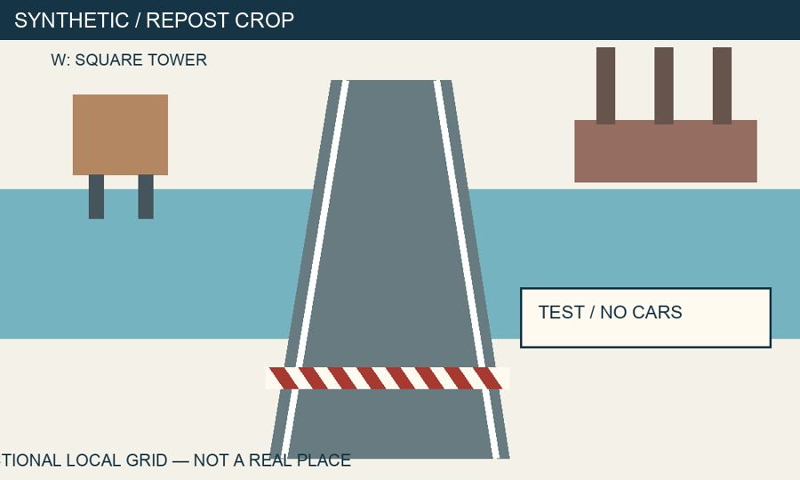

# Evidence First OSINT

**A free, evidence-led OSINT course: turn an open-source question into a reproducible report.**

[English](README.md) · [Русский](README.ru.md)

For beginners, journalists, analysts and security practitioners. Learn to assess sources, verify images and claims, preserve evidence, handle uncertainty, and explain what the available information cannot establish.

**[Start a 15-minute investigation →](https://bioxhaust.github.io/evidence-first-osint/resources/quickstart.en/)**

[Course website](https://bioxhaust.github.io/evidence-first-osint/) · [Practice](docs/practice/index.md) · [Cheatsheets & templates](docs/resources/index.md) · [English course map](docs/resources/course-map.en.md)

> **Language:** the 18 lessons, labs and worked solutions are in Russian. The English overview, course map, quickstart, core cheatsheets and report/journal/confidence templates are translated. This is not a fully bilingual course.



## What makes this useful

- **One reproducible case.** Original, clearly labelled synthetic records, images and video. No accounts, paid APIs or live search results are required for the core route.
- **Reasoning you can inspect.** Every lesson includes a worked example, independent task, success criteria, common mistakes and explained self-check answers. Labs and projects have separate solutions and scoring rubrics.
- **Uncertainty is an output.** Similar company names, repeated claims and incomplete payment records deliberately tempt false conclusions. “Insufficient evidence” can be the right answer.

## Try an actual course problem

A post says a bridge opened to cars and the full **12 million TST** contract was paid. The local ledger has two settled payments of 3 million and 2 million, a scheduled payment, and a payment for another contract. What can you substantiate?

Open the [five-minute challenge](docs/resources/challenge.md), [original ledger](docs/assets/case/payments.csv) or [bilingual confidence rubric](docs/templates/confidence.en.md). The task rewards the evidence trail and the limits of the conclusion, not a guessed flag.

## Learning route

**18 modules · 18 labs · 3 intermediate projects · 1 capstone.** Module 16 (Python/API foundations) and its lab are optional. The core route has 17 modules and 17 labs.

1. Questions, ethics, search, source evaluation and evidence preservation.
2. Images, video, geolocation, time and map accuracy.
3. Companies, procurement, passive domain records, public posts and entity resolution.
4. Data cleaning, optional Python, disinformation/AI verification and reporting.

Budget **26–34 hours** including practice and revision. The nominal core schedule is 25h 45m; optional Python adds 75 minutes. These are editorial estimates, not learner-study results.

- [Full syllabus](docs/lessons/index.md) and [30-day route](docs/resources/30-days.md).
- [Labs and projects](docs/practice/index.md), [capstone](docs/practice/capstone.md), [separate solutions](docs/solutions/index.md).
- [Search operators](docs/resources/search.en.md), [method decision tree](docs/resources/decision-tree.en.md), [media checklist](docs/resources/media-checklist.en.md).
- [Research journal](docs/templates/journal.en.md), [report template](docs/templates/report.en.md), [confidence guide](docs/templates/confidence.en.md).

## Study and reuse

Read the website or download **Code → Download ZIP**. The small CSV/JSON records can be read in a text editor; a free spreadsheet editor is convenient. You do not need Python or a local site build to study the core route.

All subjects are fictional. The course excludes intrusion, authentication bypass, leaked-data purchases, stalking and sensitive personal-data publication. Public accessibility does not waive privacy, copyright or platform conditions. Jurisdiction-specific examples are labelled; this is not legal advice for a particular investigation.

## Build and check locally

Python 3.12 is used by CI. The checks and actual environments are documented in [quality notes](docs/about/quality.md).

```sh
python3 -m venv .venv
source .venv/bin/activate
python -m pip install -r requirements-dev.txt
python -m unittest discover -s tests -v
python tools/check_fixtures.py
python -m mkdocs build --strict
python tools/check_project.py
python -m mkdocs serve
```

Activation above is for POSIX shells. PowerShell normally uses `.venv\Scripts\Activate.ps1`; Windows has not been tested. The optional fixture generator also needs ffmpeg; learners and CI use the committed assets.

## Project health and contribution

- [Research of 10 public resources, 2026-11-03](research/landscape.md), [source notes](research/primary-sources.md), [tested scope and limitations](docs/about/quality.md).
- [Contributing](CONTRIBUTING.md), [Code of conduct](CODE_OF_CONDUCT.md), [Changelog](CHANGELOG.md), [Roadmap](ROADMAP.md).
- [Ready-to-use launch drafts](launch/README.md). No claims of guaranteed popularity or measured learning outcomes.

If the course helps you, a GitHub star makes it easier for others to find it.

## Licensing

Original course text and synthetic teaching assets: **[CC BY 4.0](LICENSE-CONTENT)**. Original code (including Python, CSS, configuration and workflows) and code blocks: **[MIT](LICENSE-CODE)**. See [LICENSE](LICENSE) and [third-party notices](THIRD_PARTY_NOTICES.md) for precise scope. External links do not relicense their targets. Attribution: “Evidence First OSINT contributors”, with the repository URL, license link and a note of changes.
