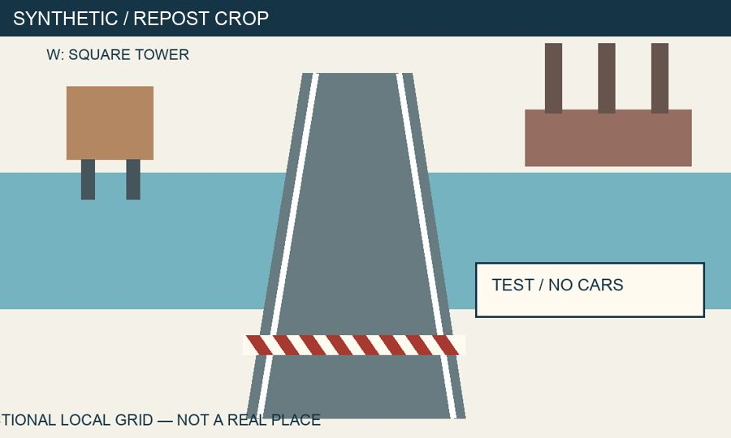

# Evidence First OSINT — Сначала доказательства

**Бесплатный курс: от вопроса по открытым источникам до воспроизводимого отчёта.**

[English](README.md) · [Русский](README.ru.md)

Для начинающих исследователей, журналистов, аналитиков и специалистов по информационной безопасности. Научитесь проверять источники, изображения и утверждения, сохранять доказательства, оценивать уверенность и объяснять ограничения результата.

**[Начать исследование за 15 минут →](https://bioxhaust.github.io/evidence-first-osint/resources/quickstart/)**

[Сайт курса](https://bioxhaust.github.io/evidence-first-osint/) · [Практика](docs/practice/index.md) · [Шпаргалки](docs/resources/index.md) · [Карта курса](docs/resources/course-map.md)

> Уроки, лабораторные и решения — на русском. На английский переведены обзор, карта, быстрый старт, основные шпаргалки и шаблоны. Полного английского перевода уроков нет.

## Три опоры курса

- **Практика, которую можно повторить.** Собственный вымышленный кейс, локальные документы, изображения и видео. В обязательном маршруте не нужны аккаунты, платные API или неизменная поисковая выдача.
- **Понятная доказательная цепочка.** В каждом уроке — метод, разобранный пример, задание, критерии и самопроверка с объяснениями. Решения лабораторных и проектов вынесены отдельно.
- **Честные ограничения.** Похожие компании, зависимые репосты и неполные платежи учат замечать ложные совпадения. «Данных недостаточно» — допустимый итог исследования.

## Настоящий пример из курса

Пост сообщает об открытии моста для машин и выплате всех **12 миллионов TST**. В журнале есть два исполненных платежа — 3 и 2 миллиона, плановый платёж и платёж по другому договору. Какие части заявления вы можете подтвердить?

[Челлендж на пять минут](docs/resources/challenge.md) · [Исходный журнал платежей](docs/assets/case/payments.csv) · [Шкала уверенности](docs/templates/confidence.md)

## Программа и практика

**18 модулей, 18 лабораторных, 3 промежуточных проекта и один итоговый кейс.** Модуль 16 о Python/API и его лабораторная дополнительны. Основной маршрут — 17 модулей и 17 лабораторных.

1. Вопросы, этика, поиск, источники и сохранение доказательств.
2. Проверка фото и видео, геолокация, время, карты и точность.
3. Компании, закупки, пассивные технические сведения, публичные посты и сопоставление сущностей.
4. Очистка данных, дополнительный Python, дезинформация, проверка ИИ и итоговый отчёт.

Планируйте **26–34 часа** с практикой и исправлениями. Номинальный основной маршрут — 25 ч 45 мин; Python добавляет 75 минут. Это редакторская оценка, не замер на учебной группе.

- [Все уроки](docs/lessons/index.md) и [план на 30 дней](docs/resources/30-days.md).
- [Практика и рубрики](docs/practice/index.md), [итоговое задание](docs/practice/capstone.md), [решения](docs/solutions/index.md).
- [Поисковые операторы](docs/resources/search.md), [дерево методов](docs/resources/decision-tree.md), [проверка медиа](docs/resources/media-checklist.md).
- [Журнал исследования](docs/templates/journal.md), [отчёт](docs/templates/report.md), [уверенность](docs/templates/confidence.md).

## Как заниматься

Откройте сайт или скачайте **Code → Download ZIP**. Небольшие CSV/JSON читаются в текстовом редакторе; для таблиц удобен бесплатный табличный редактор. Для основного маршрута установка Python не нужна. [Локальная сборка для разработчиков](docs/start.md).

Все учебные объекты вымышлены. Практика не требует взлома, обхода авторизации, покупки утечек, преследования людей или раскрытия чувствительных персональных данных. Открытая публикация не отменяет приватность, авторские права, правила сервиса и применимое право. Правовые примеры указывают юрисдикцию.

## Проверки и участие

[Исследование 10 ресурсов от 03.11.2026](research/landscape.md) · [Первичные источники](research/primary-sources.md) · [Фактические проверки](docs/about/quality.md)

[Как внести вклад](CONTRIBUTING.md) · [Правила поведения](CODE_OF_CONDUCT.md) · [Изменения](CHANGELOG.md) · [План развития](ROADMAP.md) · [Черновики для запуска](launch/README.md)

Если курс оказался полезен, поставьте звезду на GitHub: так другим будет проще его найти.

## Лицензии

Собственный текст и синтетические учебные материалы — **[CC BY 4.0](LICENSE-CONTENT)**. Собственный код, включая Python, CSS, конфигурацию, workflows и блоки кода — **[MIT](LICENSE-CODE)**. Области применения: [LICENSE](LICENSE), сторонние материалы: [THIRD_PARTY_NOTICES.md](THIRD_PARTY_NOTICES.md). Для атрибуции укажите Evidence First OSINT contributors, ссылку на репозиторий и лицензию; обозначьте изменения.
