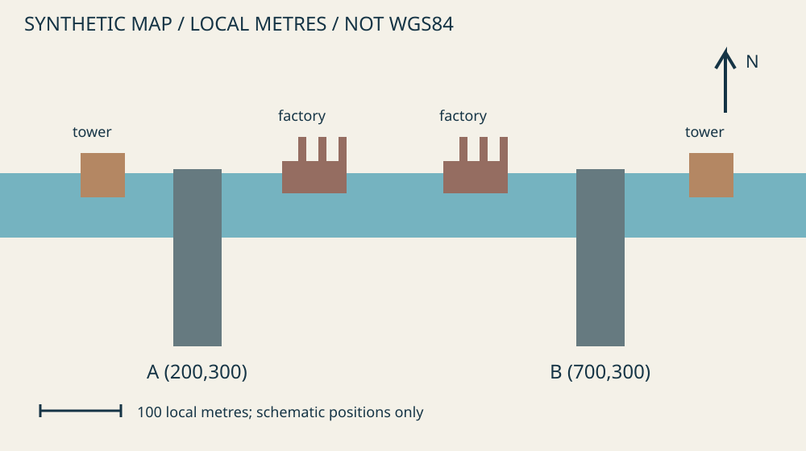

# Учебный корпус «Северная переправа»

**SYNTHETIC / УЧЕБНЫЙ МАТЕРИАЛ.** Все сведения вымышлены. Иллюстрации нарисованы программой, видео составлено из этих кадров. Это не фотографии и не запись реального события. Не ищите реальных людей, компании или адреса по учебным значениям.

Автор: Evidence First OSINT contributors. Собственные данные и изображения — [CC BY 4.0](../../about/licenses.md). Генератор — MIT. Данные созданы специально для курса; сторонние реестры и изображения не копировались. В CSV каждой строке присвоено `synthetic=true`, JSON помечен соответствующим полем, текст и изображения — видимой подписью.

## Сценарий и временная граница

Вы проверяете сообщение P01 об открытии переправы 17 мая 2025 года. Исследование ограничено состоянием на **2025-05-18T23:59:59Z**. Публикация, событие, сохранение в архиве и запуск нашего генератора — разные даты. Архивные записи здесь являются условиями задачи, а не реальным архивным сервисом.

## Документы

- [Публичные сообщения: posts.csv](posts.csv) — P01–P05; `source_ref` показывает происхождение утверждения.
- [Бюллетень B01](bulletin-01.txt) и [бюллетень B02](bulletin-02.txt).
- [Архив страницы до](archive/page-before.txt), [после](archive/page-after.txt) и [запись о старом изображении A03](archive/photo-record.txt).
- [Компании](companies.csv), [примечание о реестре](registry-notes.txt), [контракты](contracts.csv), [платежи](payments.csv).
- [Платежи с ошибками](payments-dirty.csv) — исходник для очистки; не заменяйте им чистый реестр.
- [Пассивные сведения о домене](domain-records.json), [хронология](timeline.csv), [корпус поисковых фрагментов](search-corpus.json), [локальный ответ API](api-response.json).

## Изображения и видео

- [Оригинальная иллюстрация JPEG](media/original.jpg) и [изменённая копия](media/repost.jpg).
- [Метаданные, извлечённые из файлов](media/metadata.json). EXIF изменяем, значение без часового пояса не является временем UTC.
- [Карта двух кандидатов](map.svg) и [схема ориентиров](media/scene.svg). Локальная условная сетка в метрах, **не WGS84**; изображённые координаты не предназначены для настоящей карты.
- [Учебный клип MP4](media/training-clip.mp4) — 6 секунд; [кадр 1](media/frame-01.jpg), [кадр 2](media/frame-02.jpg), [кадр 3](media/frame-03.jpg), [индекс кадров](media/frames.csv). Отдельные JPEG — исходники генерации; повторное извлечение из MP4 даст визуально близкие кадры, но не те же байты из-за сжатия.
- [Манифест SHA-256](manifest.json) — целостность файлов. Хеш подтверждает совпадение байтов с этим набором, а не истинность событий. Манифест и этот индекс исключены из хеширования во избежание самоссылки.

## Формат и ограничения

`SYN-*`, `TRAIN-*`, `TST`, `OFFICE-*` — учебные идентификаторы, юрисдикции, валюта и адреса. Общий `OFFICE-7` — коворкинг. Домены `.example` зарезервированы для примеров; IP относятся к TEST-NET. Не отправляйте к ним запросы. Разделители тысяч в `payments-dirty.csv` — пробел или запятая, дробных значений TST в схеме нет; это не универсальное правило обработки чисел.

Корпус намеренно неполон: нет данных о бенефициарах, акте допуска автомобилей, полной истории платежей вне предоставленной таблицы и точном времени создания сцены. Правильное исследование сохраняет эти пробелы.

Для проверки целостности из корня репозитория: `python3 tools/check_fixtures.py`. Генератор `tools/build_fixtures.py` требует Pillow и ffmpeg для пересоздания видео; пересоздание не требуется ученикам. Версии шрифтов и кодеков могут изменить байтовые хеши при новой генерации.
