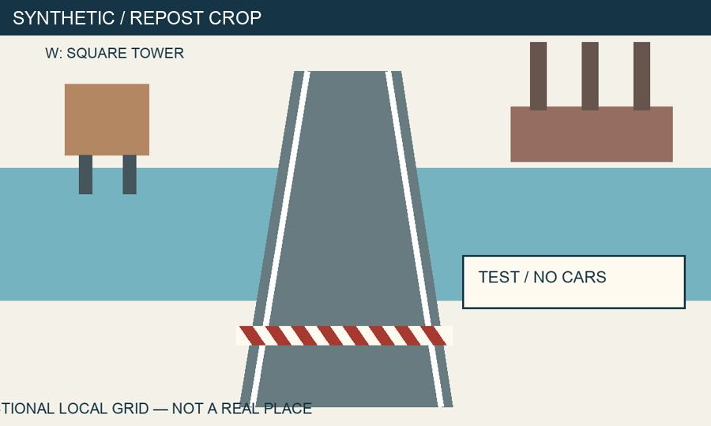

Evidence First OSINT · открытый курс

# OSINT начинается с практики.

Найдите публичные профили, запустите инструмент с GitHub и проверьте его находки. От первого ника — к доказательствам и отчёту.

20 модулей · 20 лабораторных · 3 проекта · один сквозной кейс

[Начать тренировку](trainer/index.md){ .md-button .md-button--primary }
[English overview](en/index.md){ .md-button }

20 коротких тренировок · 60 заданий с проверкой · повторение ошибок. Уроки на русском; основная практика бесплатна. Для Sherlock-лабораторной понадобятся Python и терминал. Вход через GitHub используется только для синхронизации прогресса.

## Ник → публичные профили

Сравните кандидатов, проверьте самоссылки и не объединяйте людей по одному совпавшему имени.

[Первая профильная практика](lessons/19-public-profiles.md)

## GitHub → рабочий инструмент

Запустите настоящий Sherlock на локальном стенде. Увидьте найденный профиль, ложное срабатывание и тайм-аут.

[Запустить Sherlock](lessons/20-github-tools.md)

## Вывод → границы

Укажите уверенность и оставшиеся пробелы. «Данных недостаточно» — полноценный результат.

[Взять шаблон отчёта](templates/report.md)

## Попробуйте прямо сейчас

Публикация обещает: «Мост открыт для машин, все 12 миллионов выплачены». Но в реестре две компании с похожими именами, а на фото есть люди — не автомобили. Какие утверждения вы можете проверить отдельно?

[Пройти пятиминутный челлендж](resources/challenge.md) · [Открыть лабораторную по компаниям](practice/labs/11.md)

## Для кого и сколько времени

Для начинающих исследователей, журналистов, аналитиков и специалистов по информационной безопасности. Тренажёр работает в браузере. Для полноценной практики нужны текстовый редактор, терминал и Python runtime; предварительный опыт программирования не нужен. Написание Python-кода изучается в дополнительном модуле 16.

План основного маршрута — **27 часов 45 минут**, включая лабораторные, проекты и итоговый кейс. Закладывайте **28–36 часов** с исправлениями. Дополнительное программирование на Python — ещё 75 минут. Короткий тренажёр занимает примерно 2–3 часа отдельно; курс с тренажёром и исправлениями — ориентировочно 30–39 часов. Это редакторская оценка, а не результат замера на группе учащихся.

## Выберите маршрут

- [Интерактивный путь: 60 заданий](trainer/index.md) — профильная практика с первого шага.
- [Все уроки по порядку](lessons/index.md) — от постановки вопроса до отчёта.
- [30 дней практики](resources/30-days.md) — расписание со ссылками и результатом каждого дня.
- [Только полезные материалы](resources/index.md) — поиск, медиа, выбор метода и шаблоны RU/EN.
- [Практика и рубрики](practice/index.md) — сначала сдайте свой разбор, затем откройте [решения](solutions/index.md).

## Откуда материалы

Кейс полностью вымышленный, включая компании, документы, иллюстрации и видео. Мы не распространяем скачанные фотографии людей или копии чужих реестров. [Происхождение и хеши](assets/case/README.md), [источники методов](about/sources.md) и [результаты проверок](about/quality.md) доступны отдельно.

Курс посвящён законным открытым источникам и согласованным учебным объектам. Публичная доступность не отменяет приватность, авторские права, условия сервиса и применимое право. Начните с [границ исследования](lessons/02-ethics.md).
