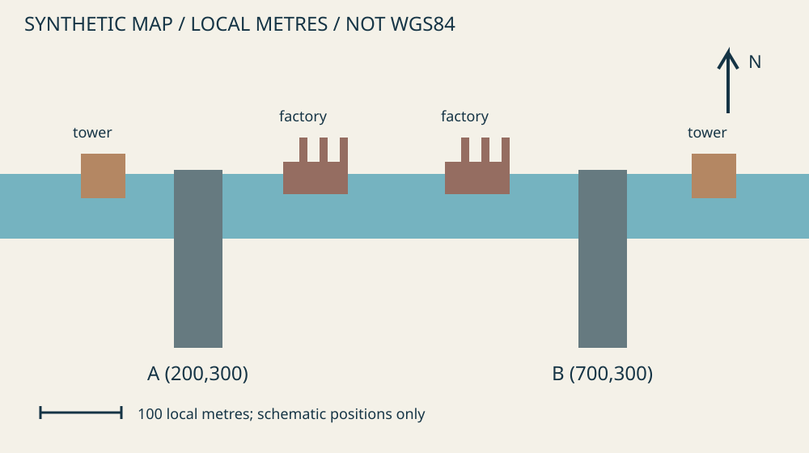

# 08. Геолокация: сравнение кандидатов

**Время: 60 минут вместе с лабораторной.** Геолокация — проверка гипотезы о месте по сочетанию признаков. Знакомый силуэт сам по себе не является ответом.

## Результат

Вы сравните два возможных места, назовёте совпадения и противоречия и запишете координаты только в той системе, в которой они заданы. Итогом будет обоснованный выбор кандидата с умеренной уверенностью, а не вымышленная точка на Земле.

## До начала

Пройдите [урок 06](06-images.md). Откройте `media/scene.svg`, исходное изображение и `map.svg` из [набора кейса](../assets/case/README.md). Карта полностью вымышленная: сетка измеряется в локальных метрах, это **не WGS84, не широта и долгота**. Поиск реальных мостов и людей не требуется.

## Метод

Сначала разделите признаки на общие и различающие. Река, мост и здания встречаются часто. Сочетание квадратной водонапорной башни с одной стороны, завода с тремя трубами с другой и подхода дороги с юга заметно полезнее. При этом несколько признаков одного здания могут зависеть друг от друга; нельзя считать каждое окно самостоятельным подтверждением.

Далее установите отношения: что рядом, на какой стороне дороги или реки, что перекрывает другой объект, какова последовательность ориентиров. **Топология** — такие отношения между объектами; она часто устойчивее субъективного сходства цвета или размера. **Перспектива** меняет видимые расстояния и масштабы. Поэтому дальнее здание может казаться рядом, а башня частично скрываться за мостом.

Ориентацию нельзя назначать автоматически. Левый край картинки не всегда запад: направление зависит от положения камеры, поворота и возможного зеркалирования. Сначала найдите опорную ориентацию по нескольким отношениям и карте. Северная стрелка относится к карте; её нельзя просто перенести на произвольный снимок. В учебной схеме стороны заданы автором и могут использоваться как условие задачи.

Сформируйте хотя бы двух кандидатов до выбора. Для каждого запишите совпадения, противоречия и неизвестное. Противоречие важнее поверхностного сходства: если башня оказывается на противоположной стороне при единой ориентации, нужно объяснить это альтернативой, а не проигнорировать. Проверяйте возможность другой точки съёмки, зеркального изображения, старой карты или изменения местности.

Уровень уверенности зависит от уникальности сочетания и полноты проверки альтернатив. Координаты с большим числом знаков не делают вывод точнее. Если карта имеет ограниченную детализацию или известны только относительные отношения, укажите район или кандидата. Для реальной геолокации ещё нужны дата карты, права на использование снимка, геопривязка и возможные смещения.

## Разобранный пример

1. Выпишите признаки учебной сцены: квадратная башня западнее переправы; завод с тремя трубами восточнее; дорога подходит с юга; на южном подходе полосатый барьер. Отдельно отметьте, какие направления основаны на предоставленной схеме, а какие были бы неизвестны у обычной фотографии.
2. Найдите кандидата A на `map.svg`: его локальная точка — (200, 300). Башня к западу, завод к востоку и южный подход согласуются с набором признаков.
3. Проверьте B: локальная точка (700, 300). У него башня и завод расположены с противоположных сторон. При заданной ориентации это противоречит схеме, хотя наличие моста и реки выглядит похоже.
4. Рассмотрите альтернативу зеркального изображения. Одного различия «слева/справа» могло бы не хватить; нужна проверка ориентации, надписей и положения дополнительных объектов. В нашем корпусе известны происхождение нарисованной схемы и её связь с картой, поэтому A лучше согласован с условиями.
5. Назначьте умеренную уверенность. Два кандидата не являются полным перечнем всех мостов; иллюстрация упрощена, а метры условны. Это учебное сопоставление, не независимое доказательство реальной географической точки.
6. Запишите результат полностью: «Среди кандидатов учебной карты лучше соответствует A, локальные координаты (200, 300) м; система не географическая. Основание — взаимное положение башни, завода и подхода; ограничение — синтетическая схема и неполный набор альтернатив».

## Самостоятельная работа

Выполните [лабораторную 08](../practice/labs/08.md). Подготовьте карточки A и B с тремя проверенными признаками, одним противоречием или неизвестностью и выводом. Затем временно уберите признак башни: останется ли достаточно оснований для выбора? Объясните, какие дополнительные сведения сделали бы ответ сильнее.

Не переносите локальные числа в онлайн-карту. Отдельно напишите, почему поиск по «200, 300» в географическом сервисе не проверяет ваш результат.

## Критерии успеха

По одному баллу: сравниваются оба кандидата; используются отношения объектов; рассмотрено противоречие; система координат и уверенность обозначены честно. Для зачёта нужны четыре балла. «Это A, потому что похоже» не засчитывается даже при правильной букве.

## Ошибки и ограничения

Не выбирайте место по одному типичному объекту. Не игнорируйте карту другой даты: сооружения могли измениться. Не считайте отсутствие здания на карте доказательством его отсутствия в местности. Не публикуйте точную локацию уязвимого человека только потому, что смогли её установить; цель и риски остаются частью исследования.

## Самопроверка

1. **Почему три подходящих отношения сильнее одного похожего силуэта?** Они совместно ограничивают пространство кандидатов и позволяют проверять противоречия.
2. **Можно ли назвать (200, 300) широтой и долготой?** Нет. Эти числа заданы в условной локальной сетке; преобразование в WGS84 отсутствует.
3. **Почему уверенность не максимальная?** Сравниваются упрощённые учебные кандидаты, а не все реальные альтернативы; исходные данные ограничены.

## Источники

- Документация системы координат: [PROJ — Projections](https://proj.org/en/stable/usage/projections.html); система и преобразование должны быть определены явно.
- Документация сообщества, не гарантия точности: [OpenStreetMap Wiki — Accuracy](https://wiki.openstreetmap.org/wiki/Accuracy).
- Дополнительно: [Bellingcat Toolkit](https://bellingcat.gitbook.io/toolkit), категории геолокации и карт.
- Ссылки проверены 2026-11-03. Все изображения этого урока — собственные синтетические материалы; внешние картографические тайлы не копируются.
